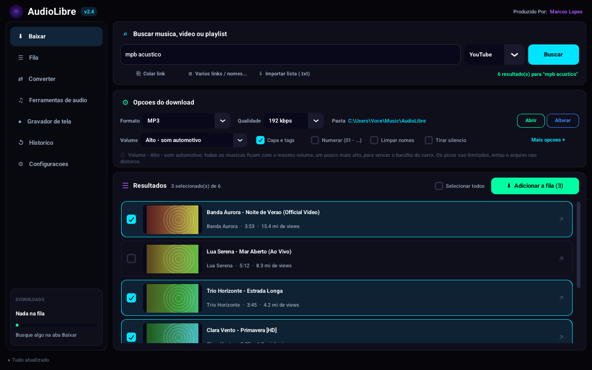
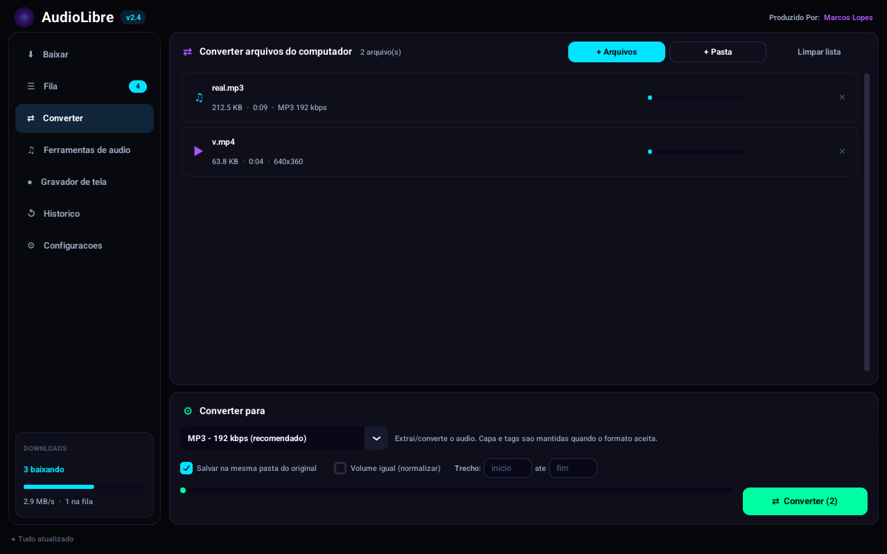

<div align="center">


# AudioLibre

**Baixe, converta e organize suas músicas e vídeos, tudo em um só programa.**

[](https://github.com/marcos-lopes22/AudioLibre/releases/latest)
&nbsp;


</div>



## O que ele faz

### ⬇ Baixar
- Busque pelo nome da música no **YouTube** ou no **SoundCloud** e veja miniatura, duração e visualizações antes de baixar.
- Cole links de **centenas de sites** (YouTube, YouTube Music, SoundCloud, Instagram, TikTok, Facebook, Vimeo e muitos outros).
- **Playlists**: escolha faixa por faixa ou baixe tudo de uma vez, em uma pasta só para ela.
- Cole **vários links ou nomes de músicas de uma vez**, ou importe uma lista em `.txt`.
- **Pula as músicas que você já baixou**, inclusive dentro de playlists.
- Baixe **só um trecho** (ex.: de 1:30 até 2:45).
- Remove automaticamente falas, introduções e propagandas dos vídeos de música (SponsorBlock).

**Formatos:** MP3, M4A, FLAC, WAV, OPUS, OGG e WMA para áudio · MP4, MKV, WebM, MOV, AVI e DVD para vídeo.

### 🔊 Volume certo para cada uso
| Perfil | Para quê |
|---|---|
| **Som automotivo** | Todas as músicas no mesmo volume, alto, gravado no próprio arquivo: funciona em qualquer rádio, pendrive ou caixa de som. |
| **Fone de ouvido** | Zero perda de qualidade: o áudio não é alterado, só ganha uma etiqueta de volume (ReplayGain) que o player usa. |
| **Padrão streaming** | O mesmo nível usado pelo Spotify e YouTube (−14 LUFS). |
| **Original** | Não mexe em nada. |

### ☰ Fila de downloads


- Vários downloads ao mesmo tempo, com **pausar, continuar e cancelar** em cada um.
- Fechou o programa no meio? A fila continua de onde parou na próxima vez.
- Ao terminar: aviso, som e, se quiser, **desligar ou suspender o PC** sozinho.

### ⇄ Converter
Converta arquivos que já estão no seu computador com perfis prontos: MP3, FLAC, MP4 em 1080p, 720p ou versão leve para WhatsApp, H.265, WebM, AVI para TVs e DVD players, DVD, GIF animado e até toque de iPhone.



### ♫ Ferramentas de áudio


- **Editor de tags e capa** (título, artista, álbum, ano, gênero), para o som do carro e o celular mostrarem tudo certinho.
- **Organizar pasta**: limpa nomes como "(Official Video)" e "[HD]", numera as faixas, preenche as tags sozinho e cria playlists `.m3u`.
- Deixar o volume igual, tirar silêncio do começo e do fim, fade in/out e cortar trechos.

### ● Gravador de tela


Grave a tela inteira ou só uma parte dela, com ou sem som, ou **só o áudio em MP3**. Para parar, use o botão ou **Ctrl+Shift+F9**, mesmo com o programa minimizado.

### E mais
- Copiou um link no navegador? O AudioLibre percebe e oferece baixar.
- Histórico com busca, para abrir, achar na pasta ou baixar de novo.
- **Atualiza sozinho**: os componentes de download acompanham as mudanças do YouTube, e as versões novas do programa se instalam sozinhas quando você fecha o AudioLibre.

## Como instalar

1. Na página de [**versões (Releases)**](https://github.com/marcos-lopes22/AudioLibre/releases/latest), baixe o **`AudioLibre_Setup_x.x.zip`** e extraia (botão direito → *Extrair tudo*). Se preferir, baixe direto o **`.exe`**.
2. Execute o `AudioLibre_Setup_x.x.exe`. Ele não pede senha de administrador.
3. **Se aparecer "O Windows protegeu o computador"** (SmartScreen): clique em **Mais informações** e depois em **Executar assim mesmo**. O aviso aparece porque o instalador ainda não tem assinatura digital paga, não porque tenha algum problema.

**Requisitos:** Windows 10 ou 11 (64 bits) e internet. O FFmpeg já vem incluso, não precisa instalar nada além do AudioLibre.

### Conferir o arquivo (opcional)
Cada versão traz um arquivo `.sha256`. Para confirmar que o instalador baixado é o original, rode no PowerShell, na pasta do download:

```powershell
Get-FileHash .\AudioLibre_Setup_2.2.exe -Algorithm SHA256
```

O código mostrado deve ser igual ao do arquivo `.sha256`.

## Perguntas frequentes

**Escolhi MP3 320 kbps. A música fica com qualidade de 320?**
O arquivo é gravado em 320 kbps, mas o YouTube entrega o áudio em cerca de 128 a 160 kbps, e não dá para recuperar detalhes que a fonte não tem. Para a melhor qualidade com o menor arquivo, use **M4A** ou **OPUS** (cópia direta do original, sem recodificar). Para tocar em qualquer aparelho, use **MP3 192 ou 320**.

**O YouTube pediu "verificação de robô". E agora?**
Espere alguns minutos e clique em **Configurações → Procurar atualizações**. Se continuar, ative **Cookies do navegador** nas Configurações. O Firefox funciona melhor.

**Como gravo o som do PC no gravador?**
Use o dispositivo **Mixagem estéreo** (Stereo Mix). Se ele não aparecer: Painel de Som do Windows → Gravação → clique com o botão direito → *Mostrar dispositivos desativados* → Ativar.

**Onde ficam as configurações e o histórico?**
Em `%LOCALAPPDATA%\AudioLibre`. O log de diagnóstico também fica lá e pode ser aberto em **Configurações → Abrir log**.

## Uso responsável

O AudioLibre é uma ferramenta para uso pessoal. Baixe apenas conteúdos que você tem o direito de baixar (seus próprios vídeos, conteúdos livres ou com permissão do autor) e respeite os termos de uso de cada site e as leis de direitos autorais do seu país. Você é responsável pelo uso que faz do programa.

## Créditos

Desenvolvido por **Marcos Lopes**.

Construído com [yt-dlp](https://github.com/yt-dlp/yt-dlp) (downloads), [FFmpeg](https://ffmpeg.org) (áudio e vídeo), [mutagen](https://github.com/quodlibet/mutagen) (tags) e [CustomTkinter](https://github.com/TomSchimansky/CustomTkinter) (interface).

© 2026 Marcos Lopes
