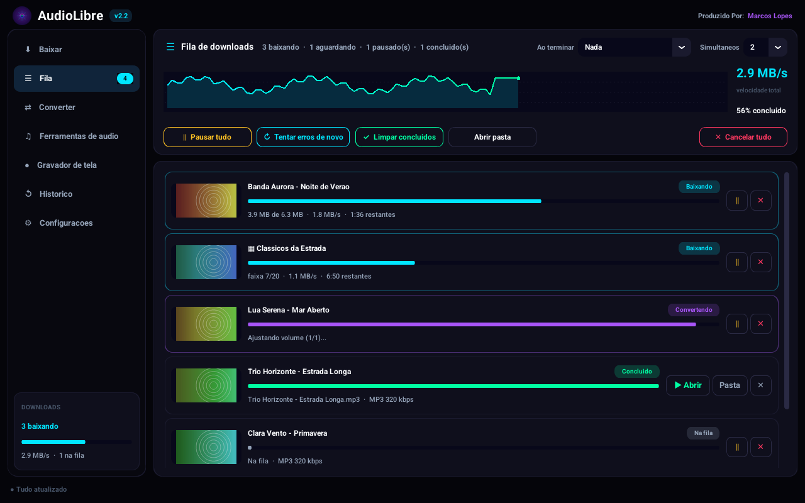
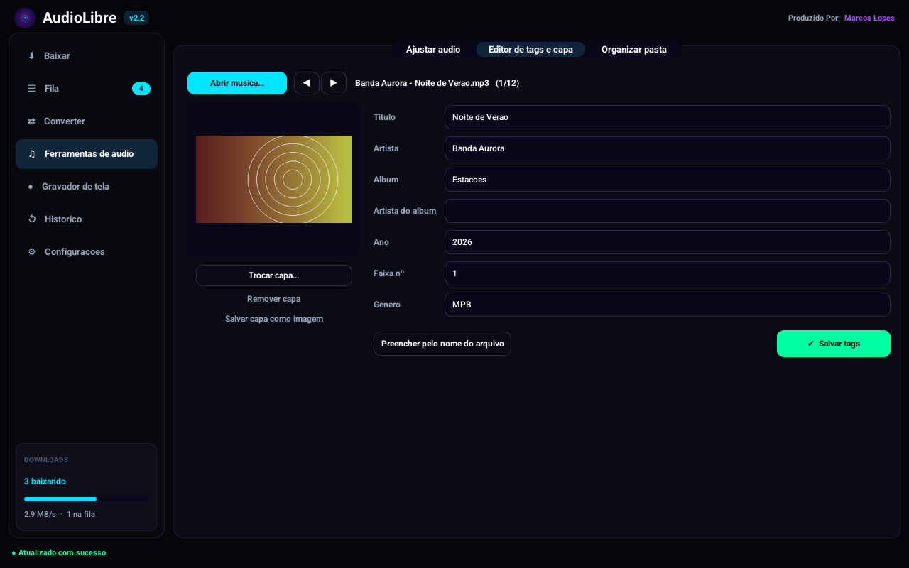
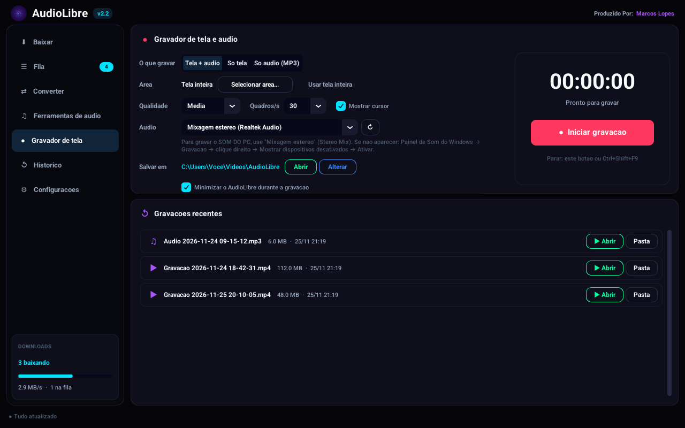

<div align="center">


# AudioLibre

**Baixe, converta, organize e grave músicas e vídeos, tudo em um só programa.**

[](https://github.com/marcos-lopes22/AudioLibre/releases/latest)
&nbsp;


</div>


O AudioLibre é um programa gratuito para Windows com cinco ferramentas: **baixar**, **fila de downloads**, **converter**, **ferramentas de áudio** e **gravador de tela**. Ele se atualiza sozinho e já vem com tudo o que precisa, sem instalar mais nada.

## O que ele faz

### ⬇ Baixar
- Busque pelo nome da música no **YouTube** ou no **SoundCloud** e veja miniatura, duração e visualizações antes de baixar.
- Cole links de **centenas de sites**: YouTube, YouTube Music, SoundCloud, Instagram, TikTok, Facebook, Vimeo e muitos outros.
- **Playlists**: escolha faixa por faixa ou baixe tudo de uma vez, numa pasta só para ela. Dá para limitar quantas faixas baixar de cada playlist.
- Cole **vários links ou nomes de músicas de uma vez** (um por linha) ou importe uma lista em `.txt`. Para os nomes, o primeiro resultado do YouTube é baixado.
- **Pula as músicas que você já baixou**, inclusive dentro de playlists.
- Baixe **só um trecho** (ex.: de 1:30 até 2:45).
- **Remove falas, introduções e propagandas** dos vídeos de música (SponsorBlock).
- **Capa e tags automáticas**: separa "Artista - Música" do título do vídeo e limpa nomes como "(Official Video)" e "[HD]". Também numera os arquivos (01 - Música), se você quiser.
- **Legendas** em português e inglês junto com os vídeos.

**Áudio:** MP3, M4A (AAC), FLAC, WAV, OPUS, OGG e WMA, com qualidade de 128 a 320 kbps.
**Vídeo:** MP4 (H.264 ou H.265), MKV, WebM, MOV, AVI e DVD, de 360p até **4K**.

### 🔊 Volume
Escolha como o volume das músicas deve ficar. A explicação de cada opção aparece embaixo do menu.

| Opção | O que faz |
|---|---|
| **Original (não mexer)** | O áudio fica exatamente como veio do site. Algumas músicas podem tocar mais altas ou mais baixas que outras. |
| **Equilibrado (recomendado)** | Todas as músicas ficam com o mesmo volume, no mesmo nível do Spotify e do YouTube. Ideal para celular, PC, fone e caixinha de som. |
| **Alto - som automotivo** | Todas as músicas ficam com o mesmo volume, um pouco mais alto, para vencer o barulho do carro. Os picos são limitados, então o arquivo não distorce. |

O ajuste é gravado no próprio arquivo, então funciona em qualquer aparelho: rádio do carro, pendrive, celular ou caixa de som.

### ☰ Fila de downloads


- Vários downloads ao mesmo tempo (você escolhe quantos), com **pausar, continuar e cancelar** em cada um ou em todos.
- Gráfico da velocidade total e **limite de velocidade**, para não travar a internet de casa.
- **Tentar de novo** os downloads que deram erro, com um clique.
- Fechou o programa no meio? A fila continua de onde parou na próxima vez.
- Ao terminar: aviso, som e, se quiser, **fechar o programa, suspender ou desligar o PC** sozinho.

### ⇄ Converter
Converta arquivos que já estão no seu computador com perfis prontos:

- **Áudio:** MP3 (320, 192 ou 128 kbps), M4A, FLAC, WAV, OGG, OPUS, WMA e toque de iPhone (M4R).
- **Vídeo:** MP4 na mesma resolução, em 1080p, em 720p ou em versão leve para WhatsApp (480p). Também H.265 (arquivo menor), WebM e AVI para TVs e DVD players.
- **Outros:** DVD (.mpg), GIF animado e troca rápida de formato (MKV ↔ MP4) sem perder qualidade.


### ♫ Ferramentas de áudio


- **Ajustar áudio:** deixa várias músicas com o mesmo volume (Equilibrado, Alto - som automotivo, Suave ou Muito alto). Também tira o silêncio do começo e do fim, faz fade in e fade out, ajusta o ganho e corta trechos.
- **Editor de tags e capa:** título, artista, álbum, ano, faixa e gênero, para o som do carro e o celular mostrarem tudo certinho.
- **Organizar pasta:** limpa nomes, numera as faixas, preenche as tags sozinho e cria playlists `.m3u`.

### ● Gravador de tela


- Grave **um monitor específico**, todas as telas ou só uma área que você seleciona.
- **Som do PC** (o que sai nas caixas ou no fone), **som do PC + microfone**, só o microfone, ou sem som.
- Também grava **só o áudio, em MP3**.
- Escolha a qualidade e os quadros por segundo (15 a 60), e se o cursor do mouse aparece.
- O AudioLibre pode se minimizar durante a gravação. Para parar, use o botão ou **Ctrl+Shift+F9**, mesmo com o programa minimizado.

### E mais
- **Copiou um link no navegador?** O AudioLibre percebe e oferece baixar, ou já coloca direto na fila, se você preferir.
- **Histórico** com busca: abra o arquivo, mostre na pasta, baixe de novo ou exporte a lista.
- **Atualiza sozinho:** ao abrir e a cada 6 horas, os componentes de download se ajustam às mudanças do YouTube. As versões novas do programa se instalam sozinhas quando você fecha o AudioLibre.
- **Atalhos:** Ctrl+V cola o link, Enter busca e Ctrl+Shift+F9 para a gravação.

## Como instalar

1. Na página de [**versões (Releases)**](https://github.com/marcos-lopes22/AudioLibre/releases/latest), baixe o **`AudioLibre_Setup_x.x.zip`** e extraia (botão direito → *Extrair tudo*). Se preferir, baixe direto o **`.exe`**.
2. Execute o `AudioLibre_Setup_x.x.exe`. Ele não pede senha de administrador.
3. **Se aparecer "O Windows protegeu o computador"** (SmartScreen): clique em **Mais informações** e depois em **Executar assim mesmo**. O aviso aparece porque o instalador ainda não tem assinatura digital paga, não porque tenha algum problema.

**Requisitos:** Windows 10 ou 11 (64 bits) e internet. O FFmpeg já vem incluso.

Depois de instalado, não precisa baixar de novo: as próximas versões chegam sozinhas.

### Conferir o arquivo (opcional)
Cada versão traz um arquivo `.sha256`. Para confirmar que o instalador baixado é o original, rode no PowerShell, na pasta do download (troque `x.x` pela versão):

```powershell
Get-FileHash .\AudioLibre_Setup_x.x.exe -Algorithm SHA256
```

O código mostrado deve ser igual ao do arquivo `.sha256`.

## Perguntas frequentes

**Qual opção de volume eu escolho?**
Para o dia a dia, **Equilibrado**. Para o carro, **Alto - som automotivo**. Use **Original** só se quiser o áudio sem nenhuma alteração.

**O volume "Alto" faz mal para os alto-falantes do carro?**
Não. Os picos do arquivo são limitados, então ele não sai distorcido. O que danifica alto-falante é o rádio ou o amplificador distorcendo no volume máximo. Se o som começar a "rachar", abaixe um pouco.

**Escolhi MP3 320 kbps. A música fica com qualidade de 320?**
O arquivo é gravado em 320 kbps, mas o YouTube entrega o áudio em cerca de 128 a 160 kbps, e não dá para recuperar detalhes que a fonte não tem. Para a melhor qualidade com o menor arquivo, use **M4A** ou **OPUS**, que copiam o áudio original sem recodificar. Para tocar em qualquer aparelho, use **MP3 192 ou 320**.

**O YouTube pediu "verificação de robô". E agora?**
Espere alguns minutos e clique em **Configurações → Procurar atualizações**. Se continuar, escolha seu navegador em **Configurações → Cookies do navegador**. O Firefox funciona melhor.

**Como gravo o som do PC no gravador?**
No menu de áudio do Gravador, escolha **"Som do PC (o que sai nas caixas/fone)"**. Não precisa ativar a "Mixagem estéreo" nem configurar nada no Windows. Para narrar junto, escolha **"Som do PC + microfone"**.

**Onde ficam as configurações e o histórico?**
Em `%LOCALAPPDATA%\AudioLibre`. O registro de diagnóstico também fica lá e pode ser aberto em **Configurações → Abrir log**.

## Uso responsável

O AudioLibre é uma ferramenta para uso pessoal. Baixe apenas conteúdos que você tem o direito de baixar (seus próprios vídeos, conteúdos livres ou com permissão do autor) e respeite os termos de uso de cada site e as leis de direitos autorais do seu país. Você é responsável pelo uso que faz do programa.

## Créditos

Desenvolvido por **Marcos Lopes**.

Construído com [yt-dlp](https://github.com/yt-dlp/yt-dlp) (downloads), [FFmpeg](https://ffmpeg.org) (áudio e vídeo), [mutagen](https://github.com/quodlibet/mutagen) (tags), [soundcard](https://github.com/bastibe/SoundCard) (som do PC no gravador) e [CustomTkinter](https://github.com/TomSchimansky/CustomTkinter) (interface).

© 2026 Marcos Lopes
